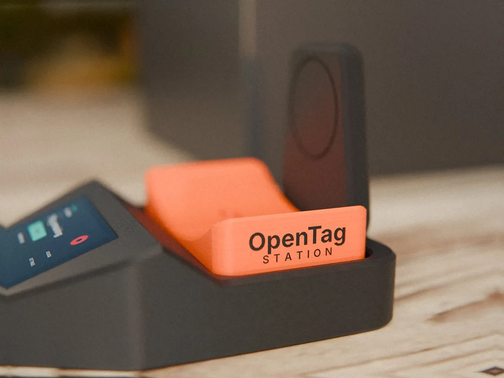
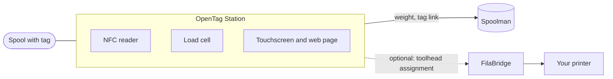
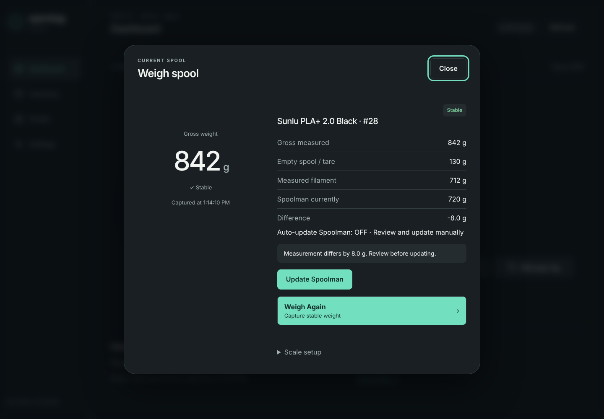
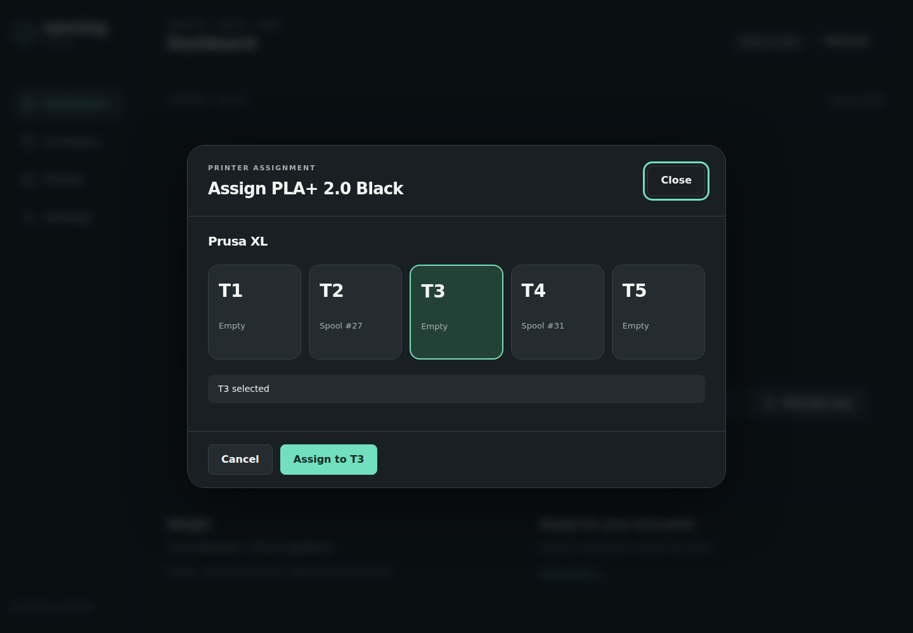
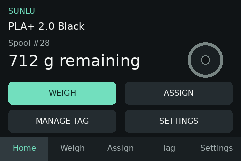
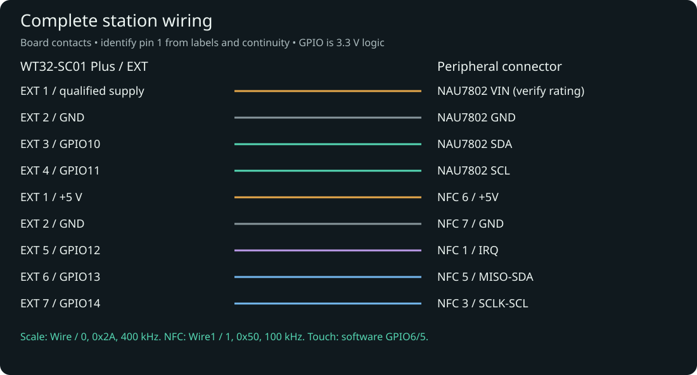

<h1 align="center">OpenTag Station</h1>

<p align="center">
  A touchscreen station for filament spools.<br>
  Put a spool on it and it reads the NFC tag, weighs the spool and keeps Spoolman up to date.
</p>

<p align="center">
  <a href="https://76cb.github.io/OpenTag-Station-Docs/">Manual</a> &nbsp;·&nbsp;
  <a href="https://76cb.github.io/OpenTag-Station/">USB installer</a> &nbsp;·&nbsp;
  <a href="https://github.com/76cb/OpenTag-Station/releases">Releases</a> &nbsp;·&nbsp;
  <a href="CHANGELOG.md">Changelog</a> &nbsp;·&nbsp;
  <a href="https://github.com/76cb/OpenTag-Station/issues">Issues</a>
</p>

<p align="center">
  <a href="https://github.com/76cb/OpenTag-Station/releases/latest"></a>
  <a href="https://github.com/76cb/OpenTag-Station/actions/workflows/ci.yml"></a>
  <a href="LICENSE.md"></a>
  <a href="https://github.com/76cb/OpenTag-Station/stargazers"></a>
</p>

<p align="center">
  
</p>
<p align="center">
  
</p>

<p align="center"><sub>Demo data.</sub></p>

## Why

If you run a few dozen spools, you eventually lose track of two things: which spool is which, and how much is left on it. Spoolman answers both, as long as someone keeps it current, and that someone is usually you, with a kitchen scale and a browser tab.

OpenTag Station moves that work to the shelf. Each spool carries an NFC tag in the [OpenPrintTag](https://github.com/OpenPrintTag/openprinttag-specification) format (the open spool-tag standard from Prusa; [which tags that means](#which-tags-it-works-with)). Set the spool on the station and it recognises the tag, finds the spool in your [Spoolman](https://github.com/Donkie/Spoolman) server, weighs it, subtracts the empty reel and shows what is left. One tap saves that number back to Spoolman. If you also use [FilaBridge](https://github.com/sargonas/filabridge) with a printer it supports (tested with a Prusa XL), a second tap tells the printer which toolhead the spool is going into. Without FilaBridge the station works the same and simply has no printer screens.



Spoolman stays the record of what you own. The station keeps no inventory of its own.

## What it does

- **Identifies a spool.** Place a tagged spool on the station and it shows which Spoolman spool it is.
- **Writes tags.** Pick a spool, or a filament to create a spool from, and the station writes a blank tag, checks it and links it to the spool.
- **Weighs and saves.** The result shows the weight, the empty spool and the filament left. Nothing changes in Spoolman until you press **UPDATE SPOOLMAN**. Automatic saving exists and is off by default.
- **Clears tags for reuse.** Erase a tag and remove its link in one step. The spool stays in Spoolman.
- **Assigns a toolhead.** Optional, and only with FilaBridge. Tell the printer which spool is in which toolhead, with a confirmation before it replaces a loaded spool or touches a printer that is printing. Without FilaBridge the station has no printer features and the Assign screens are hidden. The touchscreen shows up to five toolheads; the web page lists every toolhead FilaBridge reports (not yet tried with more than five).

Everything above works on the touchscreen. The station also serves a web page on your network for settings, inventory browsing and firmware updates.

<p align="center">
  
  
</p>
<p align="center">
  
  
</p>

<sub>All pictures are generated from demo data. The touchscreen picture is a rendering, not a photo.</sub>

## Which tags it works with

If you came here because of [OpenPrintTag](https://github.com/OpenPrintTag/openprinttag-specification), the open spool-tag format from Prusa, this is the part to read. "OpenPrintTag" and "SLIX2" are often used as if they meant the same thing. They are different layers of one tag:

| Layer | What it is | For this station |
|---|---|---|
| Data format | What is stored on the tag: material, colour, weights | OpenPrintTag |
| Radio standard | How the reader talks to the tag | ISO 15693, also called NFC-V |
| Chip | The part you actually buy | NXP ICODE SLIX2 |

A seller who lists "SLIX2" tags is selling the chip. OpenPrintTag is what the station writes onto it. In practice: buy **blank ICODE SLIX2 stickers** (ISO 15693), and the station does the rest.

Spools in the wild use several unrelated tag systems, and they are not interchangeable:

| Tag system | Chip | Where you meet it | This station |
|---|---|---|---|
| OpenPrintTag | ICODE SLIX2 (ISO 15693) | Prusament spools, and tags you write yourself | Reads and writes |
| Bambu Lab | MIFARE Classic | Bambu Lab AMS spools | Not yet, [planned](#roadmap) |
| Creality CFS | MIFARE Classic 1K | Creality spools | Not yet, [planned](#roadmap) |
| Anycubic ACE, QIDI Box | MIFARE Classic 1K | Spools for those systems | Not yet, [planned](#roadmap) |
| OpenSpool | NTAG | Community DIY tags | Not yet, [planned](#roadmap) |
| Plain NTAG213 / 215 / 216 stickers | NTAG | Phone-friendly stickers | Not yet, [planned](#roadmap) |

<sub>Chip details for other brands are as documented by [SimplyPrint](https://simplyprint.io/features/filament-management/nfc).</sub>

The reader board (ST25R3916B) is not limited to ISO 15693. Its chip and the ELECHOUSE library this project uses also support the ISO 14443 family that Bambu, Creality and NTAG tags belong to. The 1.0 firmware only looks for ISO 15693, so those spools do not show up on the station yet, and a pack of generic NTAG stickers will not work. Supporting them is on the [roadmap](#roadmap). Other ISO 15693 tags that are not SLIX2 are read today, but cannot be written. Stickers sold for phones often arrive pre-formatted and are not blank. [Which tags work](https://76cb.github.io/OpenTag-Station-Docs/openprinttag/supported-tags/) has the buying checklist and a one-minute test for a new tag.

## How it treats your data

The station writes to two things you care about, your tags and your inventory, so it is conservative about both.

- **Tag writes are verified.** Every block is read back after it is written, and the whole tag is decoded again at the end. A write that is interrupted offers to finish the next time that tag is on the reader, or to be skipped if the tag is lost.
- **No silent saves.** Weights go to Spoolman when you press the button. The station also checks that the spool it is about to update is the one it identified, and that Spoolman's copy has not changed underneath it.
- **Confirmations where it counts.** Writing over another spool's tag, clearing a tag, replacing a toolhead's spool and factory reset all ask first.
- **Updates can roll back.** After a firmware update from the browser, the station watches itself for 30 seconds and returns to the previous firmware if something is wrong. Settings and calibration survive updates.
- **Secrets stay put.** Settings exports and the API never include Wi-Fi passwords or access tokens.

## Hardware

| | |
|---|---|
| Controller | WT32-SC01 Plus (ESP32-S3, 16 MB flash, 480 × 320 touchscreen) |
| Scale | NAU7802 breakout and one YZC-133 load cell, 5 kg (default) or 2 kg |
| NFC reader | ELECHOUSE NFC_ST25R3916B module, switched to I²C mode |
| Tags | Blank NXP ICODE SLIX2 stickers (ISO 15693 / NFC-V), for OpenPrintTag. NTAG and MIFARE tags are not detected yet (see the [roadmap](#roadmap)). See [Which tags it works with](#which-tags-it-works-with). |
| Power | Regulated 5 V over USB |
| Enclosure | A three-part printed case, no supports, about 299 g of filament: [OpenTag-Station on Printables](https://www.printables.com/model/1885872-opentag-station) (CC BY-NC-SA 4.0). Assembly is in the [manual](https://76cb.github.io/OpenTag-Station-Docs/hardware/mechanical/). |

There is exactly one supported controller and one supported reader, with fixed pins, so buy the parts named in the [parts list](https://76cb.github.io/OpenTag-Station-Docs/hardware/bill-of-materials/) rather than look-alikes. The STL files live on Printables, not in this repository.

<p align="center">
  
</p>

The diagram shows electrical connections by board contact number. Read the [wiring guide](https://76cb.github.io/OpenTag-Station-Docs/hardware/wiring/) before you power anything.

## Compatibility

| Needs | Version |
|---|---|
| Spoolman | 0.26 or 0.27 to save weights. 0.27+ also uses Spoolman's own tag list. |
| FilaBridge | 1.2.1 or 1.2.2, only for toolhead assignment |
| Printer | None needed. For toolhead assignment, a printer FilaBridge supports (tested with a Prusa XL) |
| Tag format | OpenPrintTag |
| Wi-Fi | 2.4 GHz. 5 GHz-only and WPA3-only networks are not supported. |
| Browser for install | Desktop Chrome or Edge, for the USB installer |

On any other Spoolman or FilaBridge version the station stays connected and reads, writes and clears tags, but the version-gated feature (saving weights, assigning toolheads) switches off and says why. Details are in [Supported versions](https://76cb.github.io/OpenTag-Station-Docs/reference/upstream/).

## Get started

1. **Build it.** Follow the [parts list](https://76cb.github.io/OpenTag-Station-Docs/hardware/bill-of-materials/) and the [wiring guide](https://76cb.github.io/OpenTag-Station-Docs/hardware/wiring/), and print the [case](https://www.printables.com/model/1885872-opentag-station).
2. **Install the firmware.** Connect the board with a USB data cable and open the [USB installer](https://76cb.github.io/OpenTag-Station/) ([guide](https://76cb.github.io/OpenTag-Station-Docs/installation/web-flasher/)). A USB install erases all settings and the scale calibration.
3. **Join your Wi-Fi.** The touchscreen shows an open setup network named `OpenTag-Setup-XXXX`. Enter your Wi-Fi on the touchscreen, or join that network and open `http://192.168.4.1/` ([guide](https://76cb.github.io/OpenTag-Station-Docs/getting-started/first-boot/)). Afterwards the station is at `http://opentag-station.local/`.
4. **Prepare Spoolman.** On Spoolman 0.27 or later there is nothing to do. On older versions, add two extra fields of type **Text** to the **Spool** entity, with the keys `opentag_instance_uuid` and `nfc_uid` ([how](https://76cb.github.io/OpenTag-Station-Docs/inventory/custom-fields/)). Without them the station cannot link a tag to a spool.
5. **Connect and calibrate.** Enter the Spoolman address (and FilaBridge if you use it), then [tare and calibrate the scale](https://76cb.github.io/OpenTag-Station-Docs/scale/calibration/) ([guide](https://76cb.github.io/OpenTag-Station-Docs/getting-started/initial-setup/)).
6. **Write your first tag.** [Your first spool](https://76cb.github.io/OpenTag-Station-Docs/getting-started/quick-start/) walks through writing a tag, saving a weight and assigning a toolhead.

Later updates are done from the station's web page (**Settings → Update**) with `opentag-station-<version>-application.bin` from the [Releases](https://github.com/76cb/OpenTag-Station/releases) page ([guide](https://76cb.github.io/OpenTag-Station-Docs/installation/ota/)).

## Documentation

**[Read the manual →](https://76cb.github.io/OpenTag-Station-Docs/)**

| If you want to | Read |
|---|---|
| See what it does and what to buy | [Overview](https://76cb.github.io/OpenTag-Station-Docs/getting-started/overview/) |
| Use it day to day | [Identify](https://76cb.github.io/OpenTag-Station-Docs/daily-use/identify/) · [Weigh](https://76cb.github.io/OpenTag-Station-Docs/daily-use/weigh/) · [Write a tag](https://76cb.github.io/OpenTag-Station-Docs/daily-use/manage-tags/) · [Clear a tag](https://76cb.github.io/OpenTag-Station-Docs/daily-use/clear-reuse/) · [Assign a toolhead](https://76cb.github.io/OpenTag-Station-Docs/daily-use/assign/) |
| Pick tags | [Which tags work](https://76cb.github.io/OpenTag-Station-Docs/openprinttag/supported-tags/) |
| Fix a problem | [Troubleshooting](https://76cb.github.io/OpenTag-Station-Docs/troubleshooting/) |
| Secure it | [Access token and network safety](https://76cb.github.io/OpenTag-Station-Docs/configuration/security/) |
| Script it | [REST API](https://76cb.github.io/OpenTag-Station-Docs/reference/api/) · [Configuration keys](https://76cb.github.io/OpenTag-Station-Docs/reference/configuration/) |

The manual's source is in [`documentation-site/`](documentation-site/README.md). Notes for people working on the firmware are in [`docs/`](docs/README.md).

## Limits worth knowing

- The station speaks plain HTTP and is meant for a home network you trust. Do not expose it to the internet. Set an access token so only you can change it from a browser.
- Firmware files are not signed. Install only files from this repository's [Releases](https://github.com/76cb/OpenTag-Station/releases) page.
- Only blank SLIX2 tags can be written. A sticker that a phone app has already formatted is not blank, and the station will not erase it.
- 1.0 does not read Bambu Lab, Creality, Anycubic, QIDI or OpenSpool tags. They use a different tag family that the firmware does not poll for yet; see the [roadmap](#roadmap).
- There is no built-in filament catalog. Filaments and spools come from your own Spoolman.
- The station is built around one board and one reader. Other hardware is out of scope.

## Status

1.0.0 is the first release. [`VERSION`](VERSION) holds the version on `main` and the [changelog](CHANGELOG.md) lists what changed. Every version merged to `main` is published to the [Releases](https://github.com/76cb/OpenTag-Station/releases) page. Only stable versions, with no hyphen in the number, reach the [USB installer](https://76cb.github.io/OpenTag-Station/). Versions such as `1.0.1-beta.1` are marked pre-release, are for testers, and are never offered by the installer. Bugs and follow-ups are tracked in [the issues](https://github.com/76cb/OpenTag-Station/issues).

## Roadmap

1.0 does one tag system well: OpenPrintTag on SLIX2. The goal after that is to support every kind of tag the reader hardware can read or write, so one station handles whatever spools you own.

| Tag family | Spools and tags | Plan |
|---|---|---|
| MIFARE Classic (ISO 14443A) | Bambu Lab, Creality CFS, Anycubic ACE, QIDI Box | Detected and named since 1.0.1-beta.5. Read first. Write where the format allows it. |
| NTAG (ISO 14443A) | OpenSpool, plain NTAG213 / 215 / 216 stickers | Detected and named since 1.0.1-beta.5. Read and write |
| Other ISO 15693 chips | Tags that are not SLIX2 | Write support. They are read today. |
| ISO 14443B, FeliCa | Nothing on spools that the project knows of | Added if a spool system adopts them |

New tag types will follow the rules OpenPrintTag already has: writes are verified, anything that overwrites a tag asks first, and the web API never exposes raw tag access. The order and dates are not set. Progress is tracked in [the issues](https://github.com/76cb/OpenTag-Station/issues), and that is the place to say which system you want first.

## Build from source

```sh
python -m venv .venv
. .venv/bin/activate
python -m pip install --requirement requirements-dev.txt
pio test --environment native                              # host tests
pio run --environment wt32-sc01-plus                       # firmware
pio run --environment wt32-sc01-plus --target upload       # flash over USB
```

PlatformIO and all libraries are pinned. A firmware change needs a version bump (`python tools/bump_version.py <new-version>`), which CI checks, and a changelog entry written by hand. See [Build from source](https://76cb.github.io/OpenTag-Station-Docs/contributing/build/), [Testing and CI](https://76cb.github.io/OpenTag-Station-Docs/contributing/testing/) and [Contributing changes](https://76cb.github.io/OpenTag-Station-Docs/contributing/pull-requests/). Please read the [code of conduct](CODE_OF_CONDUCT.md) before opening an issue or pull request.

## Built with

[Spoolman](https://github.com/Donkie/Spoolman) and [FilaBridge](https://github.com/sargonas/filabridge) on the server side; the [OpenPrintTag specification](https://github.com/OpenPrintTag/openprinttag-specification) for tag data; [PlatformIO](https://platformio.org/) and the Arduino core for ESP32; [LVGL](https://lvgl.io/) and [LovyanGFX](https://github.com/lovyan03/LovyanGFX) for the display; [ArduinoJson](https://arduinojson.org/); and the ELECHOUSE ST25R3916 libraries for the NFC reader.

## License

[PolyForm Noncommercial License 1.0.0](LICENSE.md): free to use, change and share for noncommercial purposes. It is not an OSI-approved open-source license. The vendored ELECHOUSE NFC libraries keep their own licenses; see the [third-party notices](third_party/ELECHOUSE_ST25R3916/README.md).

## Star history

<a href="https://star-history.com/#76cb/OpenTag-Station&Date">
  <picture>
    <source media="(prefers-color-scheme: dark)" srcset="https://api.star-history.com/svg?repos=76cb/OpenTag-Station&type=Date&theme=dark">
    <source media="(prefers-color-scheme: light)" srcset="https://api.star-history.com/svg?repos=76cb/OpenTag-Station&type=Date">
    
  </picture>
</a>

<p align="center"><sub>If the station is useful to you, a star helps other people find it.</sub></p>
