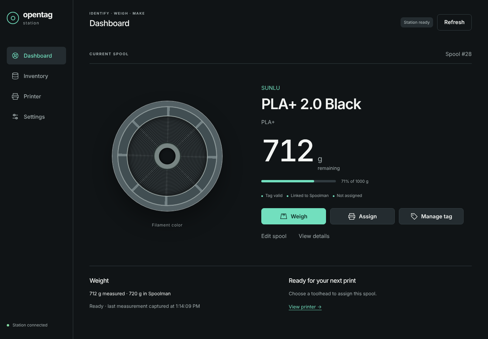

# OpenTag Station

OpenTag Station is a touchscreen station for your filament spools.
Put a spool on it: it reads the spool's NFC tag, shows which Spoolman spool it is, weighs it and
saves the remaining filament to Spoolman.
It also writes new tags from your Spoolman records and can tell a Prusa XL which spool is in which
toolhead.

*Demo data.*

## Where to start

| You want to… | Start here |
|---|---|
| See what it does and what you need | [What the station does and what you need](getting-started/overview.md) |
| Build one | [Parts list](hardware/bill-of-materials.md), then [Wiring](hardware/wiring.md) |
| Install the firmware | [Install the firmware over USB](installation/web-flasher.md), then [First boot and Wi-Fi](getting-started/first-boot.md) |
| Set it up | [Connect Spoolman and FilaBridge](getting-started/initial-setup.md) and, on Spoolman older than 0.27, the [extra fields](inventory/custom-fields.md) |
| Write your first tag | [Your first spool](getting-started/quick-start.md) |
| Use it day to day | [Identify](daily-use/identify.md), [Weigh](daily-use/weigh.md), [Write a tag](daily-use/manage-tags.md), [Clear a tag](daily-use/clear-reuse.md), [Assign a toolhead](daily-use/assign.md) |
| Fix a problem | [Find your problem](troubleshooting/index.md) |
| Script it or change the firmware | [REST API](reference/api.md), [Build from source](contributing/build.md) |

## Project status

This manual describes the release candidate shown in the footer, which is also what the
[USB installer](https://76cb.github.io/OpenTag-Station/) installs. No release has been published
yet, so the [Releases page](https://github.com/76cb/OpenTag-Station/releases) has no update file.
To move a station to a newer candidate, reinstall it with the USB installer (this erases its
settings and calibration) or [build the firmware from source](contributing/build.md).

## Links

- [USB installer](https://76cb.github.io/OpenTag-Station/)
- [Source code and issues](https://github.com/76cb/OpenTag-Station)
- [Release notes](reference/release-notes.md)
